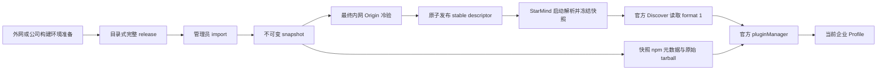

# 企业插件市场文件级详设：统一架构与决定

本文是后续实施的设计约束，不表示功能已经实现。若与之前 v0.1/v0.2 讨论稿冲突，以本执行包为准。

## 1. 范围与验收目标

公司只有不保证完整的只读 npm 镜像。员工安装 StarMind 后，能在现有 Plugins / Discover 浏览公司批准的插件，在不访问公网的条件下安装、加载、启停、更新和卸载。管理员能准备完整发布包，转入内网并上架；缺包在发布前被发现。

首版包含官方市场接入、单 stable 渠道、目录与只读 npm 服务、本机管理员导入/发布工具和离线认证。首版没有新管理网页、统一登录、部门权限、强制更新、运行时沙箱，也不兼容 dshmarket 的独立 plugins.json 界面。

## 2. 已确认的代码事实

| 项目 | 基线事实 |
|---|---|
| 用户仓库代码 | 5d8fad25d136de2371c39f87a6013ffe441e3105 |
| Beta DSH | 0.2.2-alpha.2 |
| Beta upstream 记录 | f3803c96974ad4a94195fb97e5c637e9c2a3afe3 |
| 根 Yarn | 4.18.0，node-modules linker |
| Node 要求 | ^22.19.0 或 >=24.0.0；真实 Host Node 仍须 C00 读取 |
| 随项目 pnpm | 11.28.5 |
| 企业市场已有入口 | Beta 的 profile-plugin-market.ts 可以写 plugin-market / @deepseek-ai/dsh-plugin-market 的 indexes |
| 当前默认索引 | 外网 CDN 的 realguan/dsh-plugin-market 索引 |
| 官方格式 | format 1，版本含确切 version、engines.dsh、source；npm source 可指定 registry |
| 官方管理器 | 有 registry 与 fallbackRegistries、inspect/installBundle/listVersions/updateBundle；实际打包 API 由 C01 验证 |

Stable、Beta、Next 的 upstream 版本不同。Beta 先实现与验证；Stable 的同步必须遵守变体门禁，不能因为复制文件就声明旧运行时支持新能力。Next 本轮不做新业务接入，保留门禁要求的兼容适配和原行为。

## 3. 固定架构



运行代码固定放根目录 `enterprise-market/`。它作为可独立部署的 Node 命令工具运行，首版没有新增 npm 运行依赖，也不需要加入根 Yarn workspaces；如根脚本提供入口，仅转发明确的 Node 命令，不引入第二个包管理器或独立锁文件。

详设放 `adt-cpd-workflow/enterprise-market-plan/`。工作目录 `enterprise-market/work/` 加入忽略规则；员工 Profile、下载缓存、公司真实配置和日志不能作为源码提交。

## 4. 五个核心决定

1. **协议复用**：目录只用官方 format 1，安装只用官方管理器。不给远端目录执行本机命令的能力，不新建 receipt/安装数据库。
2. **快照固定**：release.json 原始 UTF-8 字节的 SHA-256 是 snapshotId。包、版本元数据和快照内容不可变。
3. **入口可变、会话固定**：stable descriptor 可变；Host 启动解析后固定本次快照。更新快照在下次启动或明确的安全 Host 刷新后生效，不在安装过程中切换。
4. **分发完整**：公司市场提供实际需要的原始 npm tarball 和资源；服务不代理公网。只读镜像可以用于准备，但不是已上架插件的必需补包路径。
5. **验证分层**：结构校验、包下载、真实安装、bundle 加载、插件核心功能分别记录。摘要检查不等于作者身份认证；依赖齐全不等于任意插件组合完全可复现。

## 5. 信任和管理边界

V1 是由受控管理员维护的匿名内网只读服务，没有 HTTP 写入接口。导入前的目录由管理员信任；文件摘要和 HTTPS 用于检测损坏和保护传输。import 后的固定快照 URL 可以读取，但未进入 stable；“未上架”不是保密权限隔离。

企业配置使正常市场安装走公司源和批准目录，不构成对本机管理员、手工编辑 Profile 或任意第三方插件代码的安全隔离。未实施并验证的安装入口不能被宣传为已经统一管控。

上架状态在 Host 取得快照时确定；已启动 Host 不实时接收紧急撤销。撤下渠道不会删除已有包，也不会强制停用员工已加载的插件。实时吊销属于后续独立特性。

## 6. 企业本地配置和渠道描述

配置示例见 examples/enterprise-policy.example.json，类型见 contracts/contracts.ts。

本地配置至少包含 schemaVersion、mode、marketId、expectedOrigin、channelUrl、allowHttp、channelMaxAgeSeconds，可包含 caFile。它来自安装包或本机受控管理员设置，不能由远端索引扩大权限。首次进入企业模式通过管理员明确配置，不从目录内容自动开启。

`GET /channels/stable.json` 返回：

```text
schemaVersion = 1
marketId = 本地配置绑定的市场身份
channel = stable
snapshotId = 64位小写SHA-256
indexUrl = <expectedOrigin>/snapshots/<snapshotId>/dsh-index.json
registryUrl = <expectedOrigin>/npm/snapshots/<snapshotId>/
baselineId = 已认证的宿主基线
publishedAt = 渠道发布的ISO时间
```

Host 校验字段类型、市场身份、Origin、快照路径和基线；不能信任 Host 请求头拼接出的绝对 URL。生产默认 HTTPS；HTTP 仅在管理员显式允许的隔离内网或测试环境使用。证书问题不能通过关闭校验解决。

频道 TTL 从本地最后一次成功获取并验证的时间计算，不从 publishedAt 推算，否则一个长期有效的未变化市场会被误判过期。publishedAt 用于展示和诊断。

本次 Host 内共享同一个 ResolvedEnterpriseSnapshot，官方索引和管理器 registry 必须来自同一对象。原始 policy / descriptor 不能分别被不同模块重读后得到不同版本。

## 7. 客户端状态和操作

| 状态 | 允许行为 |
|---|---|
| personal | 保持现有非企业行为 |
| enterprise-resolved | 浏览公司快照；按实际管理器能力安装、更新和管理本地插件 |
| enterprise-cached | 标记上次有效缓存；按客户端章节决定是否还能确认在线可达后执行安装 |
| enterprise-stale / unavailable | 使用缓存说明来源状态；本地启停和卸载仍可用；不能悄悄切换公共源 |
| baseline-mismatch / unmanaged-profile | 不开始新包操作，明确说明需要认证基线或新企业 Profile |

企业配置损坏不能退回 personal 模式后自动联网。应保持公司模式已启用的事实，隔离市场能力并显示修复原因，允许客户端其他可用功能启动。

本轮使用官方安装确认与远程管理接口，不再叠加 v0.1 讨论稿中的 Community Market 一次性 previewId 服务。用户选择的精确版本和 registry 交给管理器；管理器负责包操作互斥、Profile 修改和已有恢复。新包的实际加载结果仍须检查。

升级基线或引入新快照不是替员工更新插件。已安装视图仍读取管理器事实。官方已安装页的版本枚举、更新、CLI 和其他市场入口须在 C07 中逐一核对：公司目录批准版本与 registry 元数据暴露版本之间的差异不能被忽略；未接通的入口禁用或明确标为本版不支持，不在验收记录中算通过。

## 8. 发布与版本规则

目录内 source 仅 npm，且每个 source.registry 指向本快照。V1 只发布稳定、明确兼容当前认证基线的插件版本。保留多个已批准版本供用户选择和管理器恢复；目录中的 latest 必须是已列出的确切版本。

npm 的 dist-tags、catalog 的 dist-tags 和企业批准清单由同一准备输入生成。不能把目录中的显示版本当成实际安装限制；须在 C07 验证官方已安装页采用的目标是否与发布策略一致。

同一个 package@version 在同一快照或全局制品库中不能出现不同内容。依赖元数据保留原有 dependencies、peer、optional、engines、dsh 和发布时刻，仅把 dist.tarball 改到明确的内部制品地址；绝不重新打包第三方 tgz 后继续使用旧 integrity。

公司基线、单插件和首批集合需要在最终快照 registry 上冷安装。支持同名多版本依赖，依赖解析由固定 pnpm 完成。未知组合要报告未认证；不自写解析器，不宣称仅凭顶层版本固定就完全可复现。

## 9. 失败处理

| 失败 | 必须做到 |
|---|---|
| 公司市场或 registry 不可达 | 返回实际来源和原因，不回退公网 |
| 结构、摘要或身份不符 | 不导入、不上架、不执行包操作 |
| prepare 缺 peer/optional/宿主包/资源 | 产出可定位的缺失清单，不把用户缓存当证明 |
| 安装/更新失败 | 使用管理器结果，区分保留旧版、已恢复和恢复失败 |
| 插件 apply 抛错 | 单列加载失败，不能把 npm 安装成功写成插件可用 |
| publish 中断或并发 | 旧 stable 继续可读，不出现半个新目录 |
| 用户关掉界面 | 已受理的管理器操作以 Host 为准，不因重复请求再执行一遍 |

## 10. 实施产物和责任

客户端精确文件、函数签名和变体同步见 02-client.md；服务端函数、schema、导入原子性、HTTP 行为及资源处理见 03-server-offline.md。任务卡只实施这些合同，不再重新选择框架。

工具和合同如有新增真实依赖，需要列确切版本、下载来源、目标平台、许可证和离线安装方式；用户已要求把需要的包随交付准备。当前随附工具全部使用 Node 内置模块，因此没有新增第三方包下载项。

## 11. 源码依据

- [StarMind 代码基线](https://github.com/Madelining/StarMind-Desktop/tree/5d8fad25d136de2371c39f87a6013ffe441e3105)
- [Beta 默认索引写入](https://github.com/Madelining/StarMind-Desktop/blob/5d8fad25d136de2371c39f87a6013ffe441e3105/dsh-plugin-desktop-beta/src/profile-plugin-market.ts)
- [Beta Profile 组合](https://github.com/Madelining/StarMind-Desktop/blob/5d8fad25d136de2371c39f87a6013ffe441e3105/dsh-plugin-desktop-beta/src/profiles.ts)
- [官方 format 1](https://github.com/deepseek-ai/deepseek-harness/blob/f3803c96974ad4a94195fb97e5c637e9c2a3afe3/.agents/notes/implemented/feature/2026-10-02-plugin-market-index-format.md)
- [官方 registry 计划](https://github.com/deepseek-ai/deepseek-harness/blob/f3803c96974ad4a94195fb97e5c637e9c2a3afe3/.agents/notes/implemented/architecture/2026-09-18-plugin-install-registries.md)

源码说明已核对；随包 runtime 的实际行为仍必须用 C01 证明，不能用文档替代运行结果。
